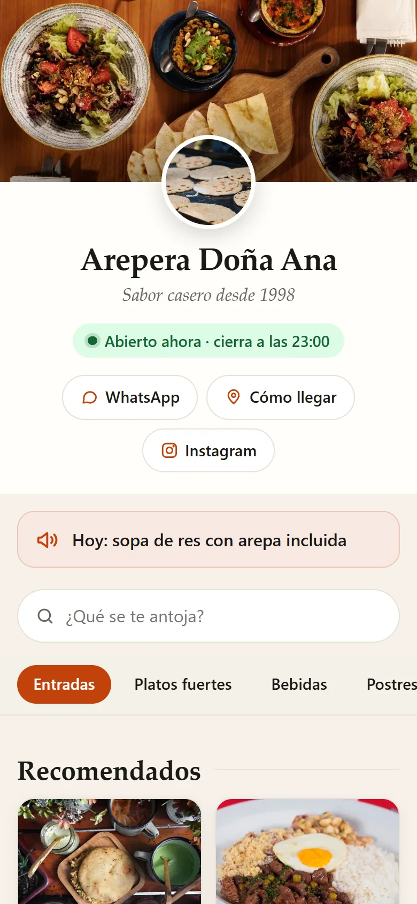
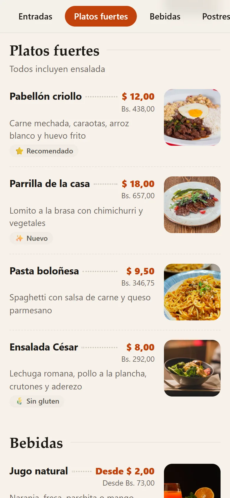
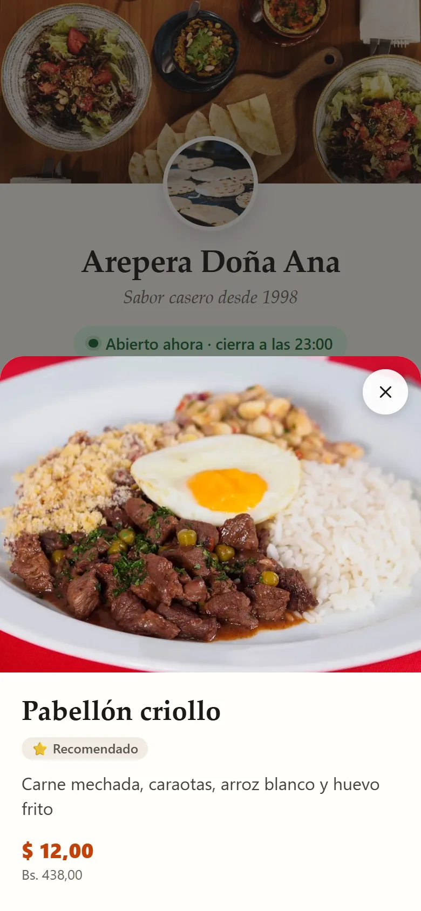
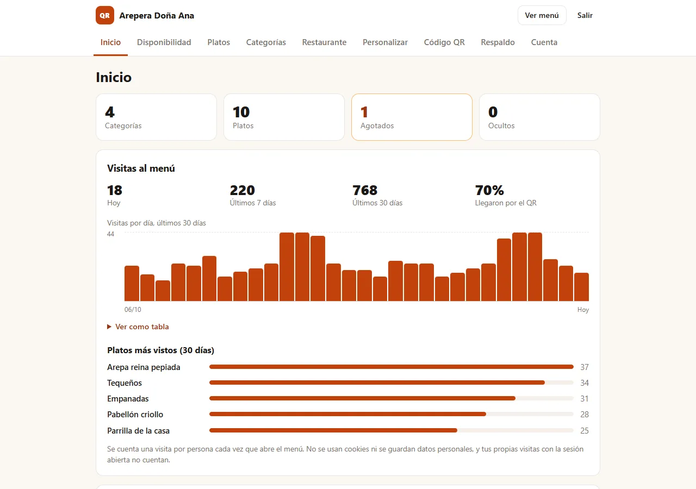
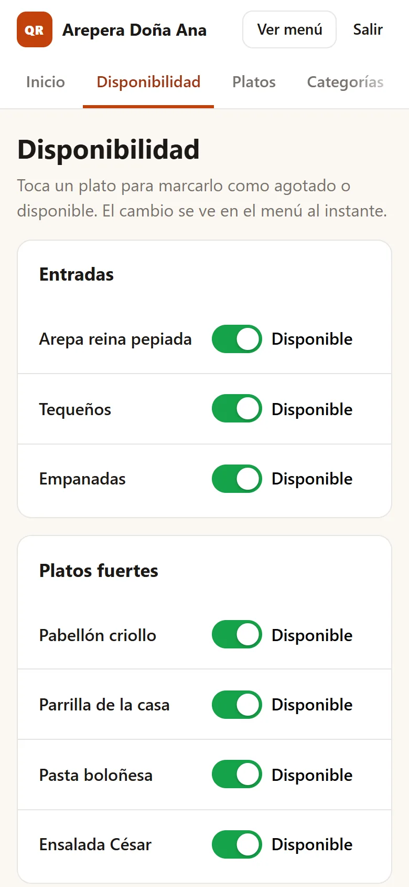
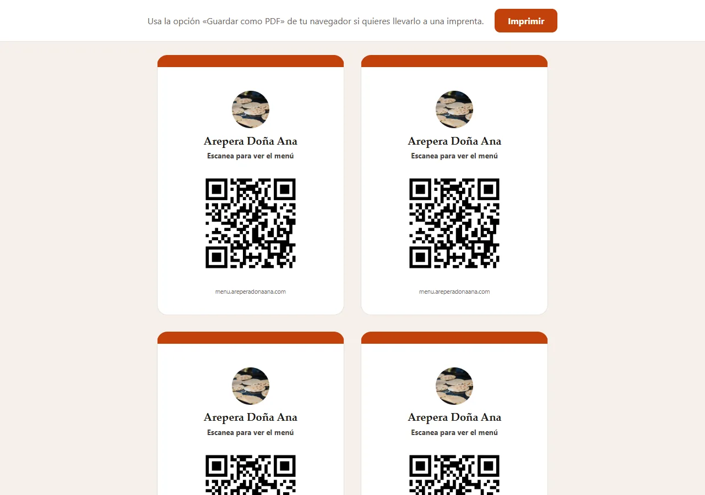

# menu-qr

**A self-hosted QR digital menu for restaurants.** Your customers scan a code on the table and see your menu on their phone. You update dishes, prices and sold-out items from your own phone. Free, open source, no monthly fees, and your data stays on your server.

**Menú digital con QR para restaurantes, en tu propio servidor.** Tus clientes escanean el código de la mesa y ven el menú en su teléfono. Tú cambias platos, precios y agotados desde tu celular. Gratis, de código abierto, sin mensualidades y con tus datos en tu servidor.

[English](#english) · [Español](#español)

<p align="center">
  
  
  
</p>

---

## English

### What it does

- **Menu for phones** — cover photo, logo, "Open now / Closed" from your opening hours, WhatsApp, directions and Instagram buttons, notice of the day, search, category tabs, recommended dishes and a detail sheet with a large photo.
- **Simple admin panel** (English and Spanish) — dishes with photo, sizes and labels (vegetarian, spicy, gluten free…), categories, and a one-tap **sold out** switch for busy service hours.
- **Two currencies** — show every price also in a second currency (for example USD and VES) calculated from the exchange rate you set; update the rate from the dashboard in seconds.
- **QR codes** — download PNG or SVG, or print ready-made table cards (one large card or four per page).
- **Visit counter without cookies** — visits per day, how many came from the QR code and the most viewed dishes. No personal data is stored.
- **Backup in one click** — download a ZIP with your whole menu and photos, and restore it on any server.
- **Fast and light** — photos are converted to WebP automatically, no external fonts or scripts, about 400 MB of RAM for the whole stack.

<p align="center">
  
</p>

### Deploy on Hostinger

There are two versions of the Compose file. Pick one:

| | Best for | Address of your menu |
|---|---|---|
| **Simple** (`docker-compose.yml`) | Trying it out, or when you do not have a domain yet | `http://YOUR-VPS-IP:8101` |
| **With your domain and HTTPS** (`docker-compose.traefik.yml`) | A real restaurant | `https://menu.yourrestaurant.com` |

**Simple:**

[](https://www.hostinger.com/docker-hosting?compose_url=https://raw.githubusercontent.com/reinalddo/menu-qr/refs/tags/v1.0.0/docker-compose.yml&REFERRALCODE=__REFERRALCODE__)

**With your domain and HTTPS** (requires Hostinger's **Traefik** template running on the same VPS — see [Custom domain with HTTPS](#custom-domain-with-https)):

[](https://www.hostinger.com/docker-hosting?compose_url=https://raw.githubusercontent.com/reinalddo/menu-qr/refs/tags/v1.0.0/docker-compose.traefik.yml&REFERRALCODE=__REFERRALCODE__)

The button opens Hostinger's Docker hosting page. After you choose a VPS plan, Hostinger prepares Docker and opens **Docker Manager** with the menu-qr Compose file loaded. Review the variables in the preview and click **Deploy**.

### Requirements

- A VPS with Docker. On Hostinger, the smallest Docker VPS plan is enough.
- 1 vCPU, 1 GB of RAM and 3 GB of free disk space (menu-qr itself uses about 400 MB of RAM).
- The simple version needs one free port (8101 by default). The domain version needs ports 80 and 443, used by Traefik.

### First use, step by step

1. **Deploy** with one of the buttons above. In the Docker Manager preview you can leave every variable as it is (see [Settings](#settings)). With the domain version, set `APP_DOMAIN` first.
2. **Open the port.** If your VPS uses Hostinger's managed firewall, go to hPanel → **VPS** → **Security** → **Firewall** and add an **Accept** rule for **TCP 8101** (or **80** and **443** for the domain version). Keep your SSH rule (port 22).
3. **Copy the setup code.** In Docker Manager → **Projects**, click **⋮** next to the project → **View logs**. Look for a box like this:

   ```
   ============================================================
    menu-qr is not installed yet.
    Open http://<server-ip>:8101/install
    Setup code: K7MX-4QPA-93TB
   ============================================================
   ```

4. **Install.** Open `http://YOUR-VPS-IP:8101/install` (or `https://your-domain/install`), paste the code, and enter your restaurant name, time zone, currency and your admin email and password.
5. **Build your menu** in the admin panel (`/admin`): categories first, then dishes. Add your logo, cover photo, WhatsApp and opening hours.
6. **Check the menu address** in **Restaurant → Menu address**. The QR code points there, so it must be the address your customers can open (your domain, once you have one).
7. **Print the QR code** from **QR code → Print 4 per page** and put it on your tables.

<p align="center">
  
  
</p>

### Settings

You can change these values in the Docker Manager preview before deploying. None of them is required for the simple version.

| Variable | Default | What it does |
|---|---|---|
| `APP_PORT` | `8101` | Public port of the menu (simple version only). Change it if 8101 is busy. |
| `APP_DOMAIN` | `menu.example.com` | **Required for the domain version.** The domain of your menu, without `https://`. |
| `MENUQR_DB_PASSWORD` | empty | Database password. Leave it empty: a random one is generated on the first start. |
| `MENUQR_DB_ROOT_PASSWORD` | empty | Database root password. Same as above. |
| `MENUQR_RECOVERY` | `0` | Set to `1` to reset a forgotten password (see below). |

Everything else (restaurant details, currency, colors, hours…) is set in the admin panel. The file [`.env.example`](.env.example) lists the same variables for people who run `docker compose` by hand.

> Changing `MENUQR_DB_PASSWORD` after the first start has no effect: MySQL only reads it when its data volume is created.

### Custom domain with HTTPS

1. In Docker Manager, deploy Hostinger's **Traefik** template from the catalog (once per VPS). It listens on ports 80 and 443 and gets free Let's Encrypt certificates.
2. In your domain's DNS, create an **A record** for the menu (for example `menu.yourrestaurant.com`) pointing to your VPS IP. Wait until it resolves.
3. Deploy menu-qr with the **domain** button and set `APP_DOMAIN` to that domain.
4. Open ports **80** and **443** in the firewall, open `https://menu.yourrestaurant.com/install` and continue with the [first use](#first-use-step-by-step).

The simple version uses plain HTTP. Use the domain version for a restaurant that is open to the public.

### Update

1. Download a backup first (**Backup → Download ZIP**).
2. Read the [CHANGELOG](CHANGELOG.md) for the new version.
3. In Docker Manager, change the image tag `ghcr.io/reinalddo/menu-qr:1.0.0` to the new version (it appears twice: in `init` and `app`) and update the project. Database changes are applied automatically when the app starts.

If you run Docker Compose yourself: change the tag in your Compose file, then `docker compose pull && docker compose up -d`.

### Backup

- **From the admin panel (recommended):** **Backup → Download ZIP** saves categories, dishes, photos, restaurant details and settings (and, if you want, the visit statistics). **Restore a backup** loads it on the same or another server. Your user, password and menu address are never part of the backup.
- **Whole server:** the data lives in three Docker volumes: `db_data` (MySQL), `app_data` (photos) and `secrets` (database passwords).

### Forgot your password?

1. In Docker Manager, set `MENUQR_RECOVERY` to `1` and update the project.
2. Open the logs: you will see a recovery code.
3. Open `/recover`, enter the code, your email and a new password.
4. Set `MENUQR_RECOVERY` back to `0` and update the project again.

### Run it on your computer

With [Docker Desktop](https://www.docker.com/products/docker-desktop/), save [`docker-compose.yml`](docker-compose.yml) in an empty folder and run:

```bash
docker compose up -d
docker compose logs app   # the setup code is here
```

Then open http://localhost:8101/install. To work on the code, use `dev/docker-compose.dev.yml`, which builds the image locally and mounts `app/`.

### Need help?

menu-qr is free and open source under the MIT license: you can use it, change it and install it for others.

If you prefer not to do it yourself, I offer **paid services**:

- Installation on your Hostinger VPS, with your domain, HTTPS and the QR code ready to print.
- Loading your menu (dishes, photos and prices).
- Customization: colors, extra features, integrations.
- Ongoing support and updates.

Write to **contacto@cobroaldia.com**. Replies in English or Spanish.

### License and credits

- menu-qr: [MIT](LICENSE) © Reinaldo Matheus.
- Third-party components, used unmodified through their official images or packages: PHP and Apache HTTP Server ([php](https://hub.docker.com/_/php) image), MySQL Community Server 8.4 ([mysql](https://hub.docker.com/_/mysql) image, GPL-2.0), [chillerlan/php-qrcode](https://github.com/chillerlan/php-qrcode) (MIT or Apache-2.0) and chillerlan/php-settings-container (MIT).
- Photos in the screenshots: [Pexels](https://www.pexels.com/license/) — Jep Gambardella, DΛVΞ GΛRCIΛ, Allan González, jessica olivella, Alberta Studios, Daigoro Folz, Rasul Yarichev, Gu Ko, Valeria Boltneva, Jana Ohajdova, Pixabay and Nishant Sharma. They are not part of the app.

---

## Español

### Qué hace

- **Menú para celulares**: foto de portada, logo, "Abierto ahora / Cerrado" según tu horario, botones de WhatsApp, cómo llegar e Instagram, aviso del día, buscador, pestañas por categoría, platos recomendados y una ficha de cada plato con foto grande.
- **Panel de administración sencillo** (español e inglés): platos con foto, tamaños y etiquetas (vegetariano, picante, sin gluten…), categorías y un interruptor de **agotado** que se activa con un toque en plena hora de servicio.
- **Dos monedas**: cada precio también en una segunda moneda (por ejemplo USD y bolívares), calculado con la tasa que indiques. La tasa se actualiza desde el inicio del panel en segundos.
- **Códigos QR**: descarga en PNG o SVG, o imprime tarjetas listas para las mesas (una grande o cuatro por hoja).
- **Contador de visitas sin cookies**: visitas por día, cuántas llegaron por el QR y los platos más vistos. No guarda datos personales.
- **Respaldo con un clic**: descarga un ZIP con todo tu menú y sus fotos, y restáuralo en cualquier servidor.
- **Rápido y liviano**: las fotos se convierten solas a WebP, sin fuentes ni scripts externos, y todo el sistema usa unos 400 MB de RAM.

### Desplegar en Hostinger

Hay dos versiones del archivo Compose. Elige una:

| | Ideal para | Dirección de tu menú |
|---|---|---|
| **Simple** (`docker-compose.yml`) | Probarlo, o si todavía no tienes dominio | `http://IP-DE-TU-VPS:8101` |
| **Con tu dominio y HTTPS** (`docker-compose.traefik.yml`) | Un restaurante en funcionamiento | `https://menu.turestaurante.com` |

**Simple:**

[](https://www.hostinger.com/docker-hosting?compose_url=https://raw.githubusercontent.com/reinalddo/menu-qr/refs/tags/v1.0.0/docker-compose.yml&REFERRALCODE=__REFERRALCODE__)

**Con tu dominio y HTTPS** (necesita la plantilla **Traefik** de Hostinger funcionando en el mismo VPS; mira [Dominio propio con HTTPS](#dominio-propio-con-https)):

[](https://www.hostinger.com/docker-hosting?compose_url=https://raw.githubusercontent.com/reinalddo/menu-qr/refs/tags/v1.0.0/docker-compose.traefik.yml&REFERRALCODE=__REFERRALCODE__)

El botón abre la página de Docker hosting de Hostinger. Cuando eliges un plan de VPS, Hostinger prepara Docker y abre **Docker Manager** con el Compose de menu-qr cargado. Revisa las variables en la vista previa y pulsa **Deploy**.

### Requisitos

- Un VPS con Docker. En Hostinger alcanza con el plan de VPS Docker más pequeño.
- 1 vCPU, 1 GB de RAM y 3 GB libres de disco (menu-qr usa unos 400 MB de RAM).
- La versión simple necesita un puerto libre (8101 por defecto). La versión con dominio necesita los puertos 80 y 443, que usa Traefik.

### Primer uso, paso a paso

1. **Despliega** con uno de los botones de arriba. En la vista previa de Docker Manager puedes dejar todas las variables como están (mira [Variables](#variables)). En la versión con dominio, primero pon tu dominio en `APP_DOMAIN`.
2. **Abre el puerto.** Si tu VPS usa el firewall administrado de Hostinger, entra a hPanel → **VPS** → **Security** → **Firewall** y agrega una regla **Accept** para **TCP 8101** (o **80** y **443** en la versión con dominio). No borres la regla de SSH (puerto 22).
3. **Copia el código de instalación.** En Docker Manager → **Projects**, pulsa **⋮** junto al proyecto → **View logs**. Busca un recuadro como este:

   ```
   ============================================================
    menu-qr todavía no está instalado.
    Abre http://<server-ip>:8101/install
    Código de instalación: K7MX-4QPA-93TB
   ============================================================
   ```

4. **Instala.** Abre `http://IP-DE-TU-VPS:8101/install` (o `https://tu-dominio/install`), pega el código y escribe el nombre del restaurante, la zona horaria, la moneda, y tu correo y contraseña de administrador.
5. **Arma tu menú** en el panel (`/admin`): primero las categorías y después los platos. Agrega tu logo, la foto de portada, tu WhatsApp y el horario.
6. **Revisa la dirección del menú** en **Restaurante → Dirección del menú**. El QR apunta ahí, así que debe ser una dirección que tus clientes puedan abrir (tu dominio, cuando lo tengas).
7. **Imprime el QR** desde **Código QR → Imprimir 4 por hoja** y ponlo en tus mesas.

### Variables

Puedes cambiar estos valores en la vista previa de Docker Manager antes de desplegar. Ninguno es obligatorio en la versión simple.

| Variable | Valor por defecto | Para qué sirve |
|---|---|---|
| `APP_PORT` | `8101` | Puerto público del menú (solo versión simple). Cámbialo si el 8101 está ocupado. |
| `APP_DOMAIN` | `menu.example.com` | **Obligatoria en la versión con dominio.** El dominio de tu menú, sin `https://`. |
| `MENUQR_DB_PASSWORD` | vacía | Contraseña de la base de datos. Déjala vacía: se genera una al azar en el primer arranque. |
| `MENUQR_DB_ROOT_PASSWORD` | vacía | Contraseña root de la base de datos. Igual que la anterior. |
| `MENUQR_RECOVERY` | `0` | Ponla en `1` para recuperar una contraseña olvidada (ver abajo). |

Todo lo demás (datos del restaurante, moneda, colores, horario…) se configura en el panel. El archivo [`.env.example`](.env.example) tiene las mismas variables para quien ejecute `docker compose` a mano.

> Cambiar `MENUQR_DB_PASSWORD` después del primer arranque no tiene efecto: MySQL solo la lee cuando crea su volumen de datos.

### Dominio propio con HTTPS

1. En Docker Manager, despliega la plantilla **Traefik** del catálogo de Hostinger (una sola vez por VPS). Usa los puertos 80 y 443 y obtiene certificados gratis de Let's Encrypt.
2. En el DNS de tu dominio, crea un **registro A** para el menú (por ejemplo `menu.turestaurante.com`) que apunte a la IP de tu VPS. Espera a que se propague.
3. Despliega menu-qr con el botón **con dominio** y pon ese dominio en `APP_DOMAIN`.
4. Abre los puertos **80** y **443** en el firewall, entra a `https://menu.turestaurante.com/install` y sigue con el [primer uso](#primer-uso-paso-a-paso).

La versión simple usa HTTP sin cifrar. Para un restaurante abierto al público, usa la versión con dominio.

### Actualizar

1. Descarga primero un respaldo (**Respaldo → Descargar ZIP**).
2. Lee el [CHANGELOG](CHANGELOG.md) de la versión nueva.
3. En Docker Manager, cambia la etiqueta de la imagen `ghcr.io/reinalddo/menu-qr:1.0.0` por la versión nueva (aparece dos veces: en `init` y en `app`) y actualiza el proyecto. Los cambios en la base de datos se aplican solos al arrancar.

Si usas Docker Compose tú mismo: cambia la etiqueta en tu archivo Compose y ejecuta `docker compose pull && docker compose up -d`.

### Respaldo

- **Desde el panel (recomendado):** **Respaldo → Descargar ZIP** guarda categorías, platos, fotos, datos del restaurante y ajustes (y, si quieres, las estadísticas de visitas). **Restaurar un respaldo** lo carga en el mismo servidor o en otro. Tu usuario, tu contraseña y la dirección del menú nunca van en el respaldo.
- **Todo el servidor:** los datos están en tres volúmenes de Docker: `db_data` (MySQL), `app_data` (fotos) y `secrets` (contraseñas de la base de datos).

### ¿Olvidaste tu contraseña?

1. En Docker Manager, pon `MENUQR_RECOVERY` en `1` y actualiza el proyecto.
2. Abre los logs: verás un código de recuperación.
3. Entra a `/recover` y escribe el código, tu correo y una contraseña nueva.
4. Vuelve a poner `MENUQR_RECOVERY` en `0` y actualiza el proyecto otra vez.

### Probarlo en tu computadora

Con [Docker Desktop](https://www.docker.com/products/docker-desktop/), guarda [`docker-compose.yml`](docker-compose.yml) en una carpeta vacía y ejecuta:

```bash
docker compose up -d
docker compose logs app   # aquí está el código de instalación
```

Luego abre http://localhost:8101/install. Para trabajar en el código, usa `dev/docker-compose.dev.yml`, que construye la imagen en tu equipo y monta la carpeta `app/`.

### ¿Necesitas ayuda?

menu-qr es gratis y de código abierto con licencia MIT: puedes usarlo, modificarlo e instalarlo para otros.

Si prefieres no hacerlo tú, ofrezco **servicios pagados**:

- Instalación en tu VPS de Hostinger, con tu dominio, HTTPS y el QR listo para imprimir.
- Carga de tu menú (platos, fotos y precios).
- Personalización: colores, funciones extra, integraciones.
- Soporte y actualizaciones.

Escríbeme a **contacto@cobroaldia.com**. Respondo en español o en inglés.

### Licencia y créditos

- menu-qr: [MIT](LICENSE) © Reinaldo Matheus.
- Componentes de terceros, usados sin modificar mediante sus imágenes o paquetes oficiales: PHP y Apache HTTP Server (imagen [php](https://hub.docker.com/_/php)), MySQL Community Server 8.4 (imagen [mysql](https://hub.docker.com/_/mysql), GPL-2.0), [chillerlan/php-qrcode](https://github.com/chillerlan/php-qrcode) (MIT o Apache-2.0) y chillerlan/php-settings-container (MIT).
- Fotos de las capturas: [Pexels](https://www.pexels.com/license/): Jep Gambardella, DΛVΞ GΛRCIΛ, Allan González, jessica olivella, Alberta Studios, Daigoro Folz, Rasul Yarichev, Gu Ko, Valeria Boltneva, Jana Ohajdova, Pixabay y Nishant Sharma. No forman parte de la aplicación.
